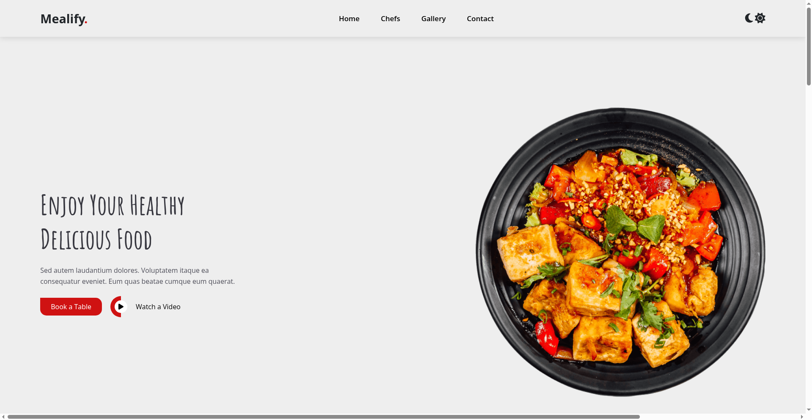

# Mealify

A restaurant landing page built with pure HTML and CSS: hero, chefs, photo gallery, dark/light toggle and a contact section with an embedded map. One of my earliest frontend projects, published as it was written, with small fixes so it deploys cleanly.

**Live demo:** https://malakmo7amed309.github.io/mealify/

## Stack

- HTML5
- CSS3 (custom, no framework)
- Font Awesome (self-hosted)

## What I fixed for publication

- Repaired two CSS image paths that pointed outside the project folder
- Restored a chef photo that was stuck as a partial `.crdownload`
- Added a real page title and social meta tags

## Run it locally

It is a static site - open `index.html`, or serve the folder:

```bash
python3 -m http.server
```

GitHub Pages serves the copy in `docs/`.

## Screenshot


