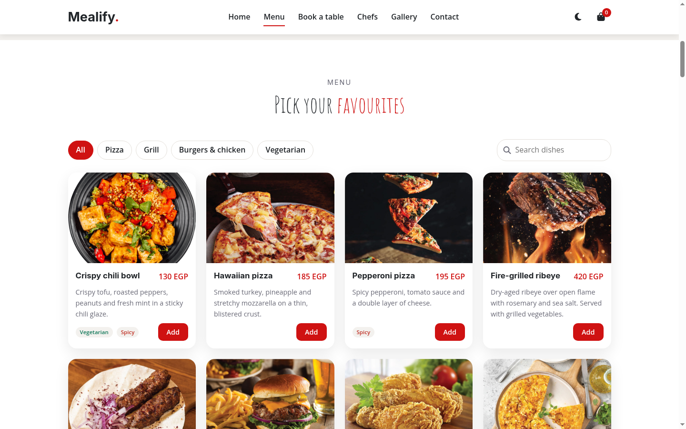

# Mealify

A restaurant site you can actually use: browse the menu, build an order, reserve a table, and contact the team. Pure HTML, CSS and JavaScript, no framework, no build step.

**Live demo:** https://malakmo7amed309.github.io/mealify/



## What it does

- **Menu** with category filters and search (8 dishes, prices in EGP).
- **Order drawer**: quantities, pickup or delivery, promo codes (`MEALIFY10`, `WELCOME15`), 12% service, delivery fee (free over 400 EGP), checkout form with validation, order history.
- **Table booking**: date, guests (1 to 10), time slots that are marked full, past or closed, confirmation with a reference, cancel from the list.
- **Live status**: "Open now" or "Closed" computed in Cairo time (Mon to Sat 11:00 to 23:00, closed Sunday).
- Gallery with a keyboard-friendly lightbox, contact form and newsletter with validation, dark and light mode (remembers your choice), mobile menu, skip link, focus styles.
- Everything you enter is saved in your browser (localStorage). This is a demo: nothing is sent anywhere, and the address and phone number are placeholders.

## Code

- `docs/logic.js`: pure functions (pricing, promos, slots, validation, opening hours) with unit tests.
- `docs/app.js`: the interface. `docs/style.css`: styling. `docs/index.html`: the page.
- The files in the repo root mirror `docs/`. GitHub Pages serves `docs/`.

## Run it

```bash
python3 -m http.server --directory docs
npm test        # 9 tests, no dependencies
```

Fonts and the icon set load from Google Fonts and the bundled Font Awesome files. Food photos are stock images.
